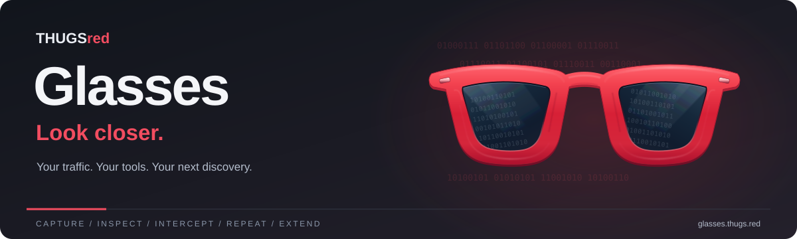
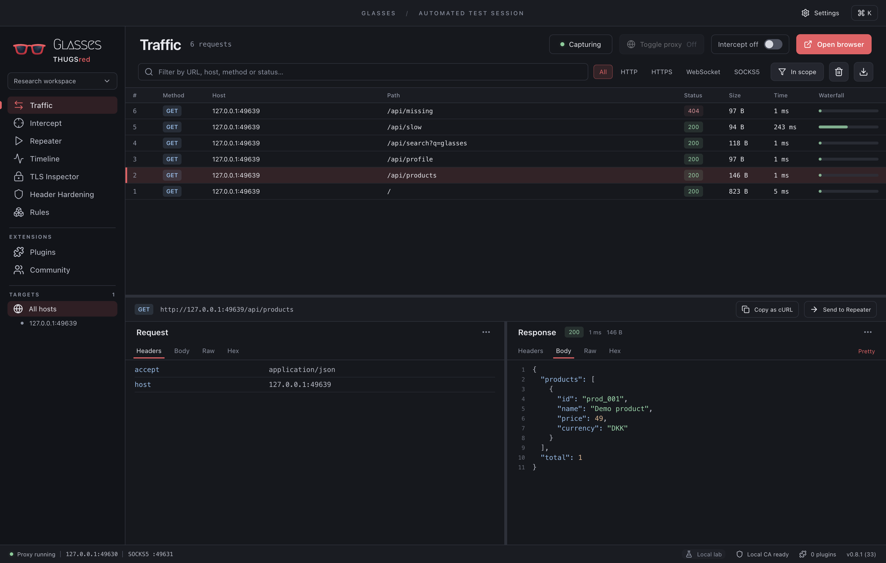
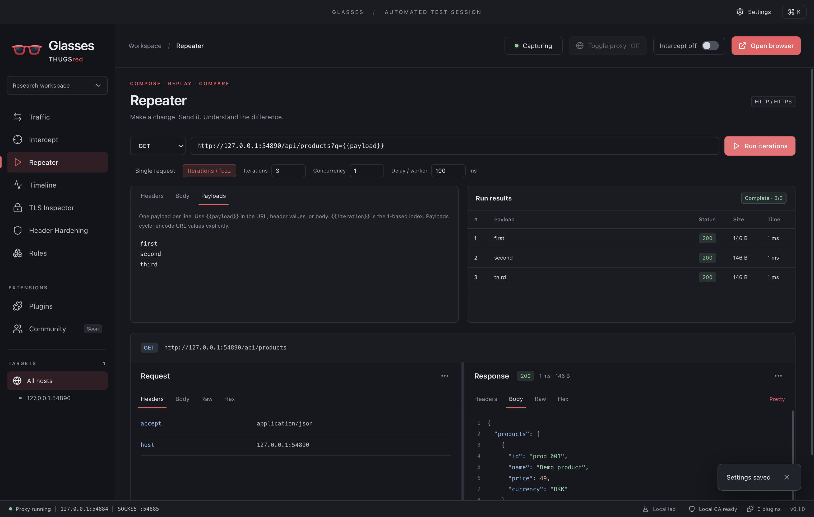
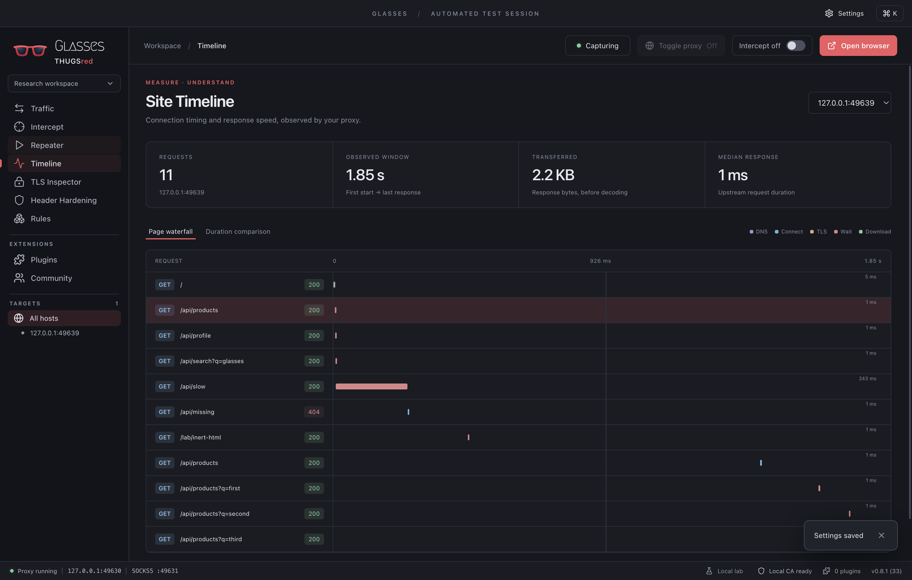
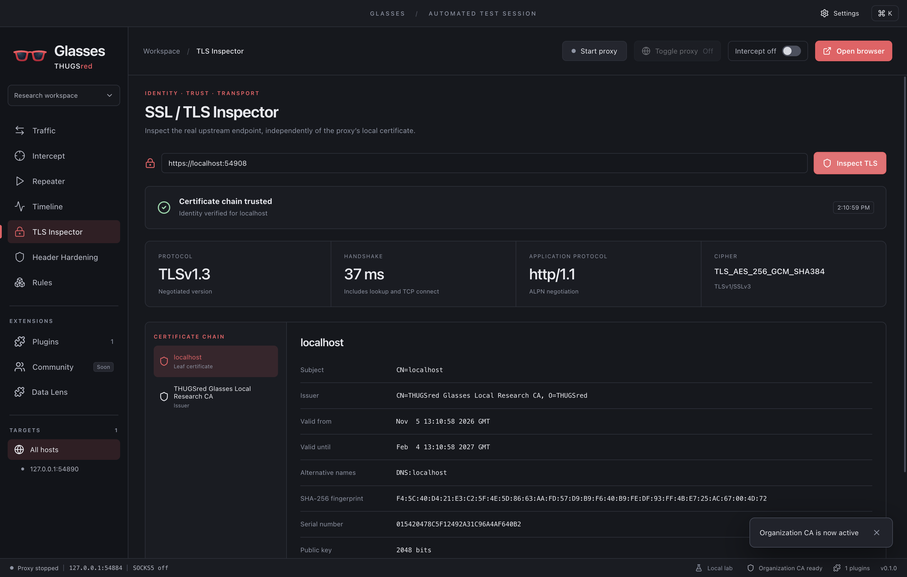
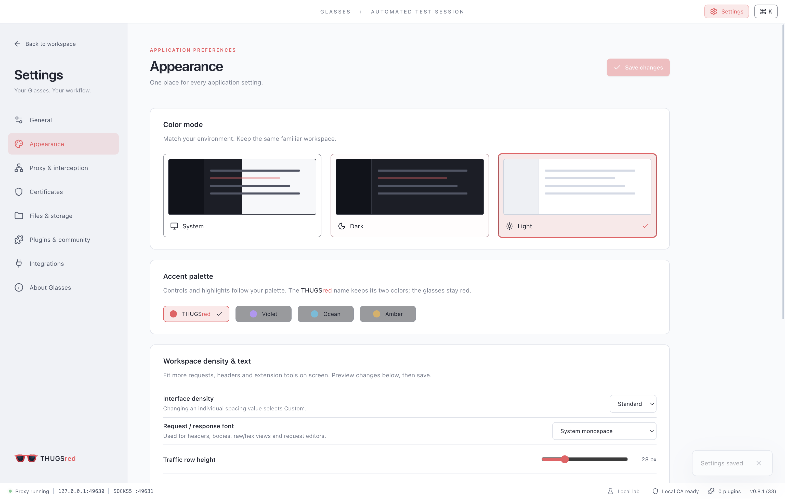
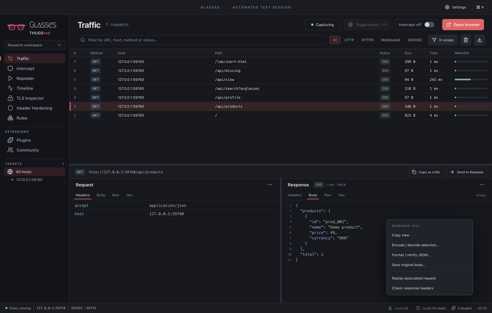
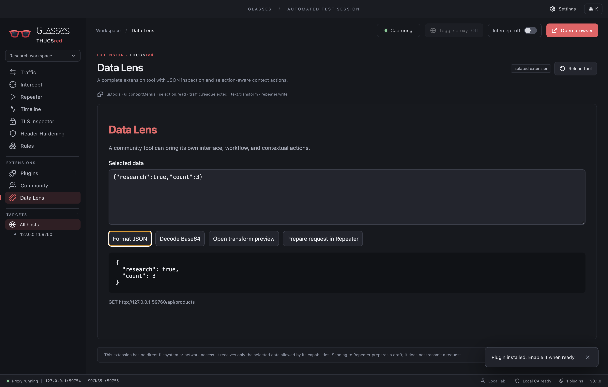
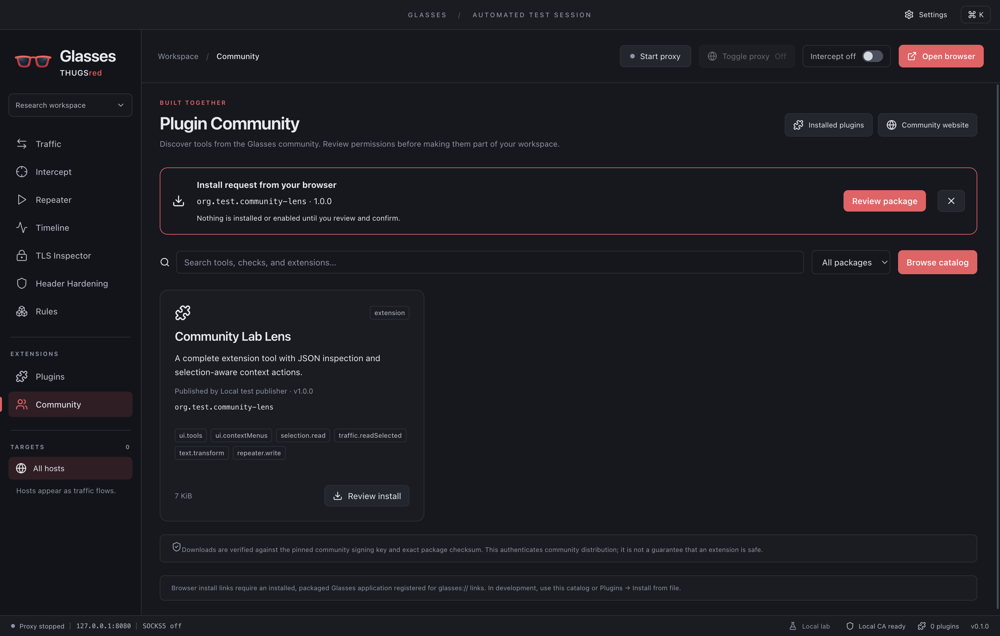

<p align="center">
  
</p>

<p align="center">
  <strong>A desktop workspace for web security research, debugging, and the next experiment.</strong><br/>
  Capture. Inspect. Intercept. Repeat. Extend.
</p>

<p align="center">
  <a href="https://glasses.thugs.red">Official website</a> ·
  <a href="docs/USAGE.md">User guide</a> ·
  <a href="plugin-sdk/README.md">Plugin SDK</a> ·
  <a href="docs/BUILDING.md">Build Glasses</a> ·
  <a href="https://github.com/kawaiipantsu/glasses/issues">Report a bug</a>
</p>

<p align="center">
  
  
  
  <a href="LICENSE"></a>
</p>



Built by the Danish hacking community **[THUGSred](https://thugs.red)**, Glasses brings an intercepting proxy, request experiments, network diagnostics, and extensible tools into one focused desktop. Inspired by the workflows of Burp Suite, Fiddler, and Proxyman, with its own red shades and a community-first direction.

**0.1 is a usable development release.** Apple Silicon is the primary tested desktop. Cross-platform packages target x64 and ARM64; Windows/Linux runtime acceptance is still in progress. See the [verification record](docs/RELEASE_NOTES.md) for what has actually been tested. Initial packages are unsigned and macOS packages are not notarized.

## Look inside

| Capture & change                                                                                                   | Inspect & understand                                                                               |
| ------------------------------------------------------------------------------------------------------------------ | -------------------------------------------------------------------------------------------------- |
| **HTTP/HTTPS proxy** with a per-install CA, safe text/raw/hex views, filtering, and HAR/session export.            | **Site Timeline** with a waterfall, connection/TLS/wait/download phases, and transfer totals.      |
| **Interceptor** to pause, edit, forward, or drop requests and responses.                                           | **TLS Inspector** for certificate chains, validity, identity, cipher, protocol, and trust results. |
| **Repeater + iterations** with payload substitution, concurrency, delays, cancellation, and per-result inspection. | **Header Hardening** with advisory CSP, CORS, HSTS, nosniff, cookie, and isolation checks.         |
| **Context menus** for cross-tool handoffs, encoding/decoding, JSON formatting, and body export.                    | **Extensions** that contribute full sidebar tools, context actions, checks, and rewrite rules.     |

<table>
  <tr>
    <td width="50%"><a href="docs/screenshots/repeater.png"></a><br/><strong>Repeat with intent.</strong> Change a request, vary payloads, inspect each result.</td>
    <td width="50%"><a href="docs/screenshots/timeline.png"></a><br/><strong>Find the wait.</strong> Understand where observed requests spend their time.</td>
  </tr>
  <tr>
    <td><a href="docs/screenshots/tls.png"></a><br/><strong>Check the connection.</strong> See the certificate chain and negotiated TLS details.</td>
    <td><a href="docs/screenshots/settings-light.png"></a><br/><strong>Make it yours.</strong> Dedicated settings, light/dark/system themes, and accent palettes.</td>
  </tr>
</table>

<details>
<summary><strong>See the response context menu and a community-style extension</strong></summary>



Right-click actions follow the data you are working with. Response text can be copied, encoded/decoded, formatted, saved, or sent into another workflow. Plugins can contribute their own relevant actions.



These are real application screenshots from the built-in local lab. The automated-test banner and temporary ports distinguish test sessions from normal research sessions.

</details>

## Your network, your workflow

- **Toggle proxy on macOS:** route system HTTP/HTTPS and SOCKS through Glasses, then restore your saved configuration. Recovery preserves settings changed by another application.
- **Corporate proxy chains:** up to eight ordered HTTP, HTTPS, or SOCKS5 hops, with per-hop authentication and no silent direct fallback.
- **Privacy bypass:** exclude hostnames, wildcard subdomains, IPs, or CIDRs from capture and interception. Excluded traffic still follows your corporate route.
- **Your own CA:** import an organization RSA signing CA and issuer chain, or use the local Glasses CA.
- **An isolated research browser:** start browsing without changing your personal browser profile. External clients can use the loopback listeners too.

See [routing, trust, and privacy details](docs/USAGE.md#corporate-routing-and-privacy), including local DNS behavior and supported authentication methods.

## Try it from source

Use **Node.js 24 LTS** and npm. macOS also needs Xcode command-line tools for the native proxy helper.

```sh
git clone https://github.com/kawaiipantsu/glasses.git
cd glasses
npm ci
npm run dev
```

1. Click **Local lab** to generate real requests against a server on your own machine.
2. Select a request and explore its headers, body, raw message, and hex view.
3. **Send to Repeater**, change a value, and send it again.
4. Click **Open browser** when you are ready to inspect a browsing session.

Default listeners are `127.0.0.1:8080` for HTTP/HTTPS and `127.0.0.1:1080` for SOCKS5. Change them in Settings if occupied. HTTPS inspection requires the active CA to be trusted by your client; Glasses never installs OS certificate trust automatically. The [user guide](docs/USAGE.md) explains setup and everyday workflows.

## Build from one place

Keep one source checkout on your Mac and initiate every platform build from it:

```sh
npm run release:all       # macOS, Linux, Windows → release/
npm run release:windows   # local Docker/Wine worker
npm run release:linux     # local Docker or disposable SSH worker
```

Configure workers once in the ignored `.glasses-build.json`. Workers receive a temporary application-only snapshot; results return to the Mac and working copies are removed. [Setup, requirements, signing, and native build commands →](docs/BUILDING.md)

| Platform | Architectures               | Packages              |
| -------- | --------------------------- | --------------------- |
| macOS    | Apple Silicon / Intel       | `.dmg`, `.zip`        |
| Windows  | ARM64 / x64                 | NSIS `.exe` installer |
| Linux    | ARM64 / x64 (Debian: amd64) | `.deb`, `.tar.gz`     |

## Build something for Glasses

The extension API supports **complete tools**, **view-specific context menus**, **header checks**, and **rewrite rules**. Declare capabilities, package a local manifest, and install it through the Plugins pane. UI extensions run in sandboxed frames with a constrained bridge.

- [SDK contract and starter examples](plugin-sdk/README.md)
- [Developer manual — Extension API v1](output/pdf/Glasses-Developer-Manual-API-v1.pdf)
- [Tutorial companion archive](output/pdf/Glasses-Developer-Manual-Companion.zip)

The Community pane supports catalog browsing, Ed25519-verified downloads, browser install links, and permission-reviewed updates. Connections are opt-in; manual file installation remains available. The website service is deployed separately, and live catalog acceptance is pending. [Installation and trust details →](docs/COMMUNITY.md)

<details>
<summary><strong>Preview the Community install flow</strong></summary>



The real application UI above uses a signed local test fixture. It demonstrates the app-side flow while the separate backend is being brought online.

</details>

## Guides worth keeping

| Guide                                                              | What is inside                                                                   |
| ------------------------------------------------------------------ | -------------------------------------------------------------------------------- |
| [Illustrated user manual](output/pdf/Glasses-0.1-User-Manual.pdf)  | 22 pages of screenshots, workflows, routing, trust, privacy, and troubleshooting |
| [Product overview](output/pdf/Glasses-Product-Overview.pdf)        | Four-page introduction to share with your team                                   |
| [Developer manual](output/pdf/Glasses-Developer-Manual-API-v1.pdf) | Extension API, worked examples, UI/UX, permissions, and compatibility            |
| [Security architecture](SECURITY.md)                               | Trust boundaries, controls, verification, and known limits                       |

## Designed for hostile input

Captured HTML and JavaScript stay inert in the inspector. The application renderer has no Node access; Electron sandboxing, context isolation, CSP, and validated IPC separate untrusted traffic from application privileges. Extensions use capability-limited bridges. Capture budgets, timeouts, and bounded iteration jobs keep experiments manageable.

Security is ongoing engineering work. See [SECURITY.md](SECURITY.md) for specifics and private reporting guidance. Version 0.1 is not independently audited or presented as an enterprise-hardened product.

Current boundaries: HTTP/1.1 inspection; SOCKS5 TCP tunnels with metadata; WebSocket upgrade passthrough without frame editing. HTTP/2/3, UDP, NTLM/Kerberos, and PAC execution are not implemented. Header checks are advisory and Timeline measures proxy observations, not browser rendering.

## Contribute

Bug reports, focused improvements, and new extensions are welcome. Start with [CONTRIBUTING.md](CONTRIBUTING.md), run `npm run check`, and include a small reproduction or screenshot when it helps. Keep captured secrets and private CA keys out of issues and pull requests.

The desktop uses **Electron + React + TypeScript**, with an independently testable **Node.js proxy core**. [Architecture and project map →](docs/USAGE.md#project-map)

## License

**CC BY-NC 4.0 plus an explicit workplace permission.** You may study, modify, and share Glasses non-commercially with attribution. The additional permission allows internal business use, private modifications, and paid security consulting using Glasses as a tool. Selling or commercially distributing Glasses or a derivative requires separate permission.

Read [LICENSE](LICENSE) for the full scope and [the unchanged CC legal text](LICENSES/CC-BY-NC-4.0.txt). Third-party components retain their own licenses. This is source-available software with commercial redistribution restrictions.
